# GW2 ArcDPS Stability Tach

A Guild Wars 2 [ArcDPS](https://www.deltaconnected.com/arcdps/) plugin that shows your party's boons as a **tachometer**.
Each 1000 rpm segment is one party member (name + stacks), so five players at full stacks read 5000 rpm - and the dial catches fire.

> **Created by [Claude](https://www.anthropic.com/claude) (Anthropic)** in a collaborative session with the repository owner, who
> directed the design, tested it in-game and supplied the debug logs that shaped it. See [Credits](#credits).

## Demos

> These animations are **rendered from simulated party data** by [`tools/render_demos.py`](tools/render_demos.py), a Python port of the
> plugin's drawing code (same geometry, presets and fire logic). They are not in-game screen captures: in game the text uses ImGui's font
> and the numbers come from ArcDPS (about 2.65 s late). The skin art in the last demo is a generated placeholder.

| | |
|---|---|
| <b>Default theme</b><br>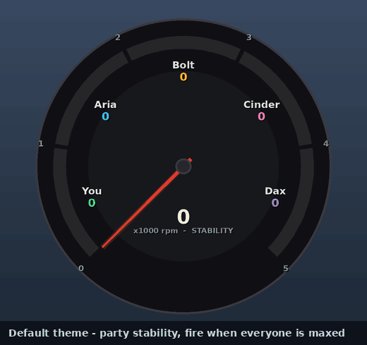 | <b>Toyota Altezza preset</b><br>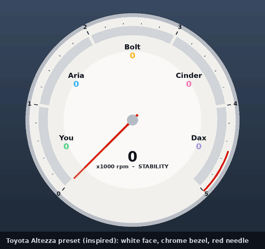 |
| <b>Toyota Starlet preset</b><br>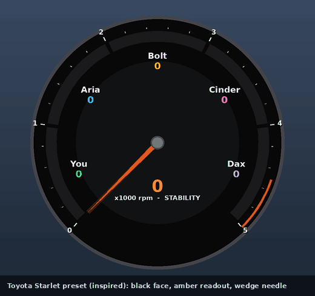 | <b>Lexus LFA preset</b><br>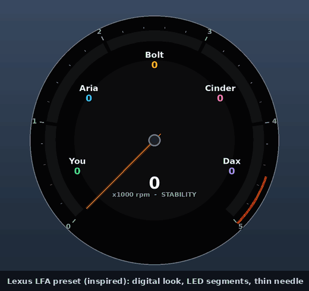 |
| <b>Half dial</b><br>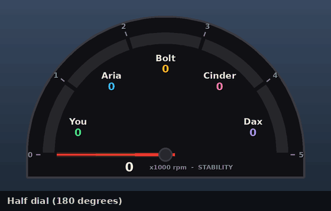 | <b>Shift-light bar</b><br>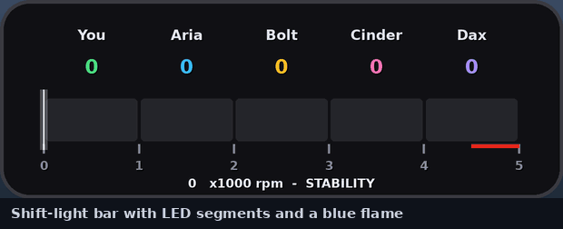 |
| <b>Combined dial (several boons averaged)</b><br>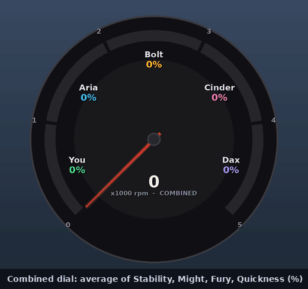 | <b>Customisation (fill, needle, ticks, colours)</b><br>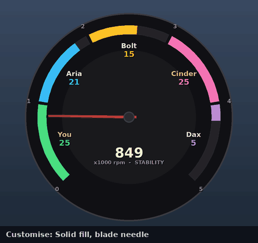 |
| <b>Window: resize and opacity</b><br>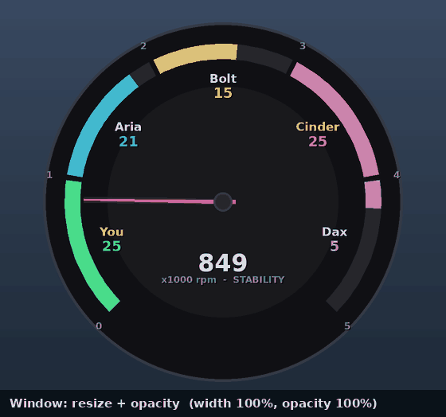 | <b>Skin image (layering and opacity)</b><br>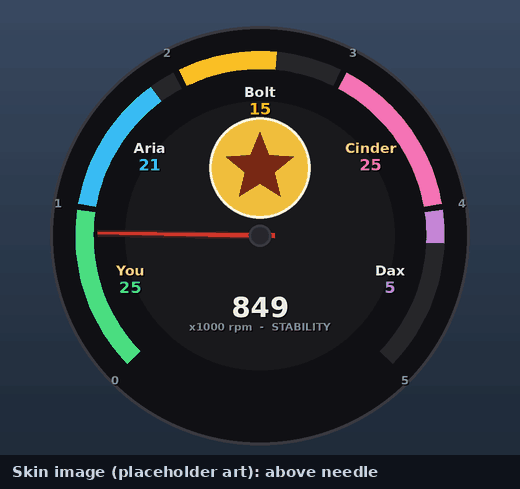 |

**Several boons at once, as separate dials** (Stability, Might, Fury, Quickness):

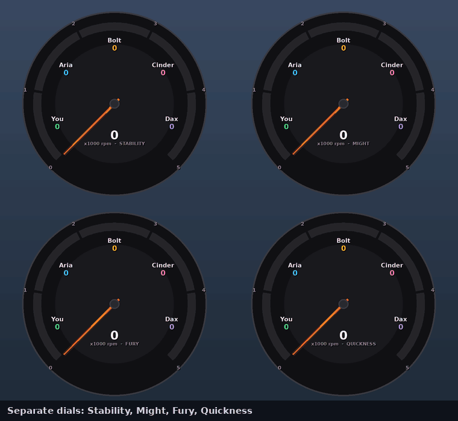

Regenerate them with `python3 tools/render_demos.py` (needs Pillow).

## Features

**Gauge**
- One segment per party member (up to 5), filling with their boon stacks; needle = total across the party (max 5000 rpm).
- Only shows in a party/squad (2+ players); optional *Show when solo*.
- Roster from your own subgroup, or the first 5 players seen.
- Fire effect when everyone is maxed - on/off, colour and intensity are configurable.
- Optional **skin image** (PNG/JPG) drawn at the dial centre, above or below the needle, with size/opacity/offset controls.

**Boons**
- Track any of: Stability, Might, Fury, Quickness, Alacrity, Protection, Regeneration, Swiftness, Vigor, Aegis, Resistance, Resolution.
- Pick one, or several: **separate dials** (up to 4 in a grid) or **one combined dial** (average fill, shown as %).
- Might and Stability fill by stacks (max 25); duration-stacking boons show on/off.

**Themes**
- Dial **type**: round (270°), half (180°), or horizontal shift-light **bar**.
- **Shape** (circle / rounded square), **needle style** (blade / thin line / wedge / none), **fill** (solid / LED segments),
  **ticks** (none / major / minor), **redline zone**, bezel width, and 10 colour slots (face, bezel, text, ticks, track, hub, readout, ...).
- Per-player stability colours, or red-to-green by stack count.
- Presets: *Default*, *Toyota Altezza*, *Toyota Starlet*, *Lexus LFA*, *Half dial*, *Shift bar*. The three car presets are
  **original stylings inspired by** those clusters (white face / black face with amber readout / dark digital look) - not copies of any
  manufacturer artwork - and are fully editable.

**Window**
- Resize by dragging, or with the width slider (aspect ratio is kept); lock position & size; click-through; opacity; reset position.
- Right-click the tach for every option (also available under ArcDPS options -> Stability Tach).
- All settings persist in `addons/arcdps/arcdps_stability_tach.ini`.

**Timing**
- *Events only* (default): a stack lives from ArcDPS's apply event to its remove event - no timers.
- *Delay-corrected timers*: drops stacks at their true expiry using a configurable feed delay (default 2650 ms).

**Diagnostics**
- Optional **debug log** (`addons/arcdps/stability_tach/debug.log`) that rolls at 5 MB to `debug.log.1`: raw agent events, boon events and whether
  they matched a tracked player, statechange counters, and a periodic roster dump. Used to find the issues listed below.
- **Demo mode** with fake data to try themes without a group.

## Install

1. Download `d3d11_arcdps_stability_tach.dll` from the latest [Release](../../releases) (or the Actions artifact), or build it (below).
2. Put it next to your other ArcDPS plugins and restart the game.
3. *(Optional)* save a skin image as `addons/arcdps/stability_tach/skin.png`. No image is bundled - use art you have the right to use.

Requires ArcDPS (DX11). The plugin must be built against the same Dear ImGui version as your ArcDPS: ArcDPS refuses to run the window on a
version mismatch and logs `imgui version mismatch: A != B`. Set `ARC_IMGUI_TAG` in `CMakeLists.txt` (19270 = v1.92.7) and rebuild.

## Build (Windows, MSVC, x64)

Needs Visual Studio 2022 Build Tools ("Desktop development with C++"), CMake and an internet connection (no git or vcpkg needed):

```
cmake -B build -S . -A x64
cmake --build build --config Release
```

Output: `build/Release/d3d11_arcdps_stability_tach.dll`. CMake downloads Dear ImGui (pinned) and stb as zip files.
Or push to GitHub: `.github/workflows/build.yml` builds on a Windows runner and attaches the DLL; pushing a tag like `v1.1.1` also creates a Release.

## How it works

ArcDPS delivers combat events to plugins through its `combat` callback. The plugin keeps a table of party members and, per member and boon,
the live set of buff stacks.

- Newer ArcDPS encodes buff events as **statechange** events (BuffApply 69, BuffChange 70, BuffRemoveSingle 71, BuffRemoveAll 72, plus
  BuffInitial 18) carrying a per-stack id; the plugin tracks stacks by that id. Older-style events are still handled.
- Agent-added events provide names and subgroup (`dst.team`).
- ArcDPS delays its combat feed by about 2.65 s on purpose, so **new stacks and strips appear about 2.65 s after they happen**. This is a
  limit of ArcDPS's API, not something a plugin can remove.

## Known limitations / status

- Version 1.1.1 (themes, multi-boon) is new and lightly tested; the stability tracking itself was verified in-game against debug logs.
- Skill ids for the non-stability boons come from commonly published GW2 ids; if a boon reads wrong, enable the debug log.
- Duration-stacking boons are assumed to report stack events like stability does; they are treated as on/off.
- Car presets are approximations from memory and meant as starting points.
- The skin image loads from a file; DX11 only.

## Project layout

`src/main.cpp` plugin glue, event handling and options UI - `src/tracker.*` per-player boon stacks - `src/gauge.*` rendering and layouts -
`src/settings.*` ini + theme presets - `src/boons.h` boon table - `src/skin.*` DX11 texture loader - `src/log.*` rolling log.
`tools/render_demos.py` generates the demo GIFs in `docs/gifs/`.
`tests/` holds a logic test (stack tracking, presets, settings round trip) and stub headers for syntax-checking without Windows/ImGui.

## Credits

- **Built by Claude (Anthropic)**, directed and tested by the repository owner.
- **[ArcDPS](https://www.deltaconnected.com/arcdps/)** by deltaconnected - the plugin API and event feed this depends on.
- **[GW2 ArcDPS Boon Table](https://github.com/knoxfighter/GW2-ArcDPS-Boon-Table)** by knoxfighter - the original inspiration. No code was copied;
  this plugin was written from scratch against the ArcDPS API.
- **[Dear ImGui](https://github.com/ocornut/imgui)** by Omar Cornut and contributors (MIT) - UI and drawing.
- **[stb_image](https://github.com/nothings/stb)** by Sean Barrett (public domain / MIT) - image loading for the skin.
- **[arcdps-rs](https://zerthox.github.io/arcdps-rs/arcdps/)** by zerthox - documentation used for the statechange numbers and agent-event semantics.
- **[arcdps-boon-magnifier](https://github.com/mutinylaboratories/arcdps-boon-magnifier)** by mutinylaboratories - its write-up of the newer statechange buff
  encoding and ArcDPS's ~2.65 s feed delay explained why early builds saw no buff events.

## Disclaimer

Not affiliated with or endorsed by ArenaNet, NCSoft, deltaconnected, Toyota or Lexus. Guild Wars 2 is a trademark of NCSoft/ArenaNet; Toyota,
Altezza, Starlet, Lexus and LFA are trademarks of their respective owners and are used only descriptively to name style presets. No third-party
artwork is included. This plugin only reads the combat events ArcDPS provides to plugins; use it in line with ArenaNet's third-party tool policy.

## License

MIT - see [LICENSE](LICENSE).
